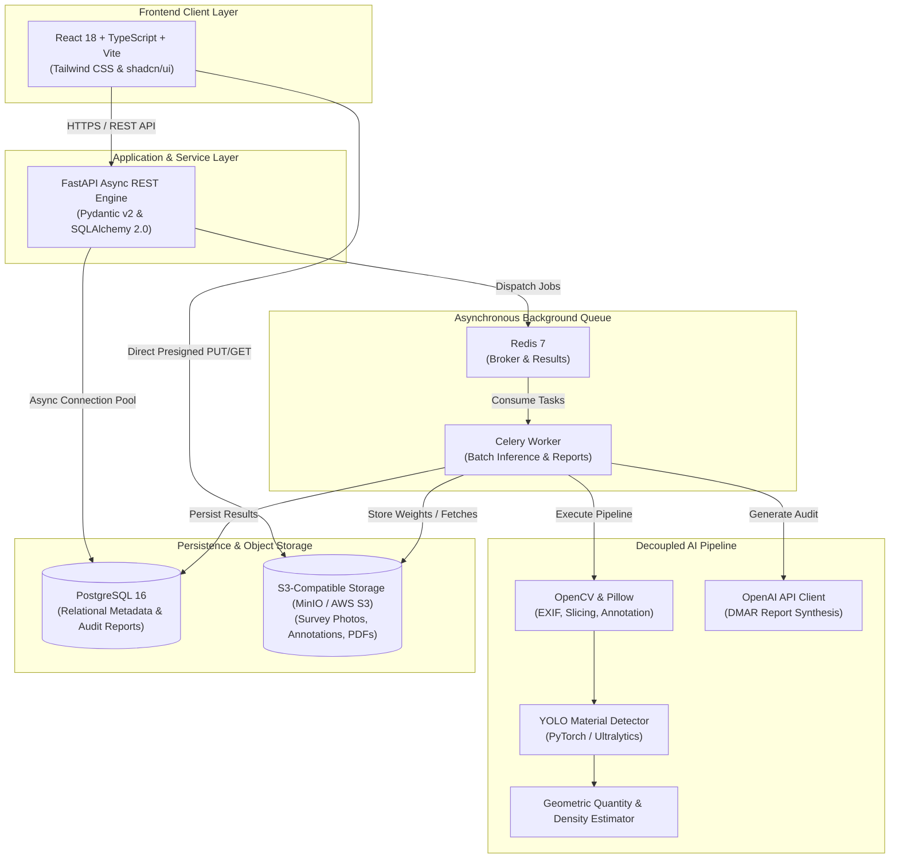

# Demolition Intelligence & Material Recovery: System Architecture

## 1. System Objective & Domain Context
The **Demolition Intelligence & Material Recovery** platform addresses the critical challenge of construction and demolition (C&D) waste. Modern demolition projects generate billions of tons of debris, the majority of which is landfilled or improperly downcycled.

This platform introduces an AI-powered pipeline that:
1. Ingests visual evidence (drone photogrammetry, handheld inspection images, 360° scans).
2. Uses deep learning computer vision (YOLOv8/v11, PyTorch, OpenCV) to identify, localize, and segment recoverable construction materials across six baseline categories:
   - **Concrete** (crushed aggregate, structural slabs, foundation elements)
   - **Bricks** (reclaimed facing bricks, refractory masonry)
   - **Steel** (structural I-beams, rebar, trusses, corrugated cladding)
   - **Timber** (hardwood beams, dimensional lumber, rafters)
   - **Glass** (architectural facades, window panes, cullet)
   - **Mixed Demolition Debris** (rubble, plaster, unsorted spall)
3. Estimates physical quantities (surface area in $m^2$, volume in $m^3$, tonnage in metric tonnes).
4. Assesses physical condition grades (`REUSABLE_EXCELLENT`, `REUSABLE_GOOD`, `RECYCLABLE`, `DOWN_CYCLE_ONLY`, `HAZARDOUS_CONTAMINATED`).
5. Computes market financial valuation and circular embodied carbon offsets ($kg\ CO_2e$ saved).
6. Uses Generative AI (OpenAI API) to synthesize regulatory-compliant Demolition Material Audit Reports (DMAR) and buyer matching insights.
7. Connects demolition contractors directly to secondary material buyers and recycling centers.

---

## 2. High-Level C4 Container Architecture

---

## 3. Modular Decoupling & Architectural Boundaries

### 3.1. Clean Separation of Concerns
1. **Frontend (`/frontend`)**: Completely autonomous SPA. Interacts with the backend solely via standard JSON REST endpoints (`/api/v1`) and authenticated S3 presigned URLs. Does not include internal business logic or model execution.
2. **Backend API (`/backend/app`)**: Lightweight, high-throughput asynchronous gateway. Responsible for authentication, CRUD operations, presigned upload authorization, Celery job dispatch, and relational data management.
3. **Decoupled AI Pipeline (`/backend/ai_pipeline`)**: Isolated module with explicit interfaces (`BaseMaterialDetector`, `BaseQuantityEstimator`, `BaseConditionClassifier`). Can be packaged as an independent container or worker library. Enforces the principle of **never faking AI deep learning**: if fine-tuned weights are absent, it strictly raises `ModelWeightsNotFoundError` and provides clear training guidance.
4. **Celery Worker (`/backend/app/workers`)**: Offloads heavy CV inference and external OpenAI calls away from the user-facing web request cycle.

---

## 4. Circular Economy & Carbon Offset Mechanics

### 4.1. Volumetric Mass Estimation
$$\text{Weight (tonnes)} = \text{Volume } (m^3) \times \text{Bulk Density } (\text{tonnes}/m^3) \times \text{Packing Factor}$$

Where bulk densities (based on CIRIA & EPA standards):
- Concrete: $2.40\ \text{t}/m^3$
- Bricks: $1.80\ \text{t}/m^3$
- Steel: $7.85\ \text{t}/m^3$
- Timber: $0.65\ \text{t}/m^3$
- Glass: $2.50\ \text{t}/m^3$
- Mixed Debris: $1.50\ \text{t}/m^3$

### 4.2. Embodied Carbon Offset Calculation
$$\text{Offset } (kg\ CO_2e) = \text{Weight (tonnes)} \times \text{Carbon Factor } (kg\ CO_2e/\text{tonne}) \times \text{Condition Multiplier}$$

- Direct reuse (`REUSABLE_EXCELLENT`): Multiplier = $1.20$ (avoids extraction and manufacturing)
- Reconditioning (`REUSABLE_GOOD`): Multiplier = $1.00$
- Crushing/Remelting (`RECYCLABLE`): Multiplier = $0.80$ (reprocessing energy subtracted)
- Downcycling (`DOWN_CYCLE_ONLY`): Multiplier = $0.35$

