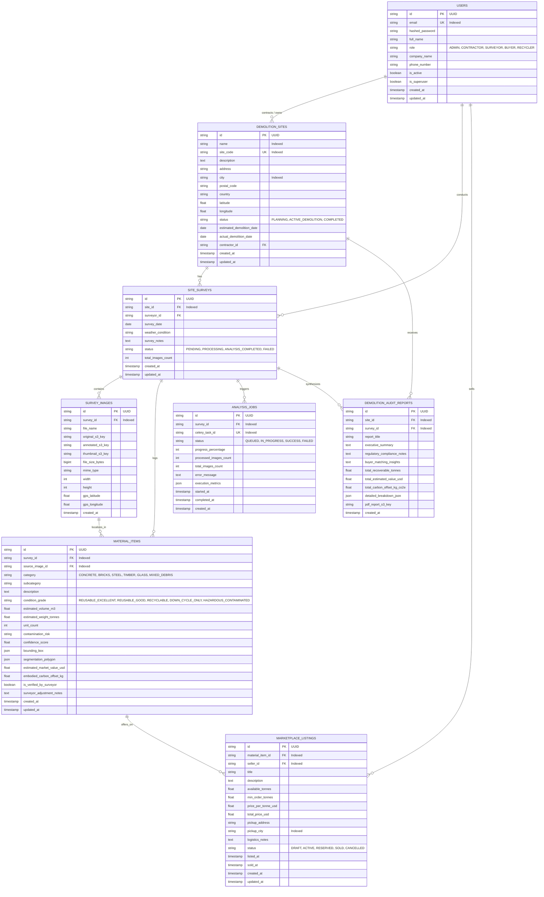

# Database Architecture & Entity-Relationship (ER) Diagram

The persistence layer for **Demolition Intelligence & Material Recovery** is implemented on PostgreSQL 16 utilizing SQLAlchemy 2.0 with asynchronous connection pooling (`asyncpg`) and transactional integrity.

## 1. Entity-Relationship Diagram

---

## 2. Table Specifications & Cardinality Rules

| Parent Entity | Child Entity | Cardinality | Cascade Action | Rationale |
| :--- | :--- | :---: | :--- | :--- |
| `users` | `demolition_sites` | $1 : N$ | `CASCADE` | Sites belong to the primary contractor/creator account. |
| `demolition_sites` | `site_surveys` | $1 : N$ | `CASCADE` | Surveys represent chronological inspection sessions for a site. |
| `site_surveys` | `survey_images` | $1 : N$ | `CASCADE` | Image records are scoped strictly to the inspection survey. |
| `site_surveys` | `material_items` | $1 : N$ | `CASCADE` | Material items belong to the survey session where detected. |
| `survey_images` | `material_items` | $1 : N$ | `SET NULL` | Deleting an image leaves the logged material item intact with historical metadata. |
| `site_surveys` | `analysis_jobs` | $1 : N$ | `CASCADE` | Background jobs track asynchronous processing for the survey. |
| `material_items`| `marketplace_listings` | $1 : N$ | `CASCADE` | Marketplace offers depend on verified material items. |
| `site_surveys` | `demolition_audit_reports` | $1 : N$ | `CASCADE` | Audit reports synthesize the survey's aggregated data. |

---

## 3. Database Indexing Strategy
- **Primary Keys**: High-entropy UUID v4 strings for distributed ID generation and horizontal partitioning compatibility.
- **Foreign Keys**: Every foreign key is explicitly indexed to avoid full table scans during joins and cascade deletions.
- **Geographic & Search Indexes**: `city` and `site_code` are indexed for fast contractor filtering and logistics queries.
- **Enum Indexes**: Status fields (`JobStatus`, `SurveyStatus`, `ListingStatus`) are indexed to optimize dashboard queries and polling workers.

